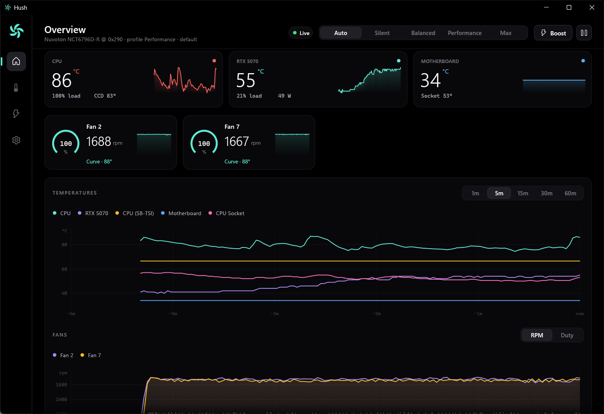
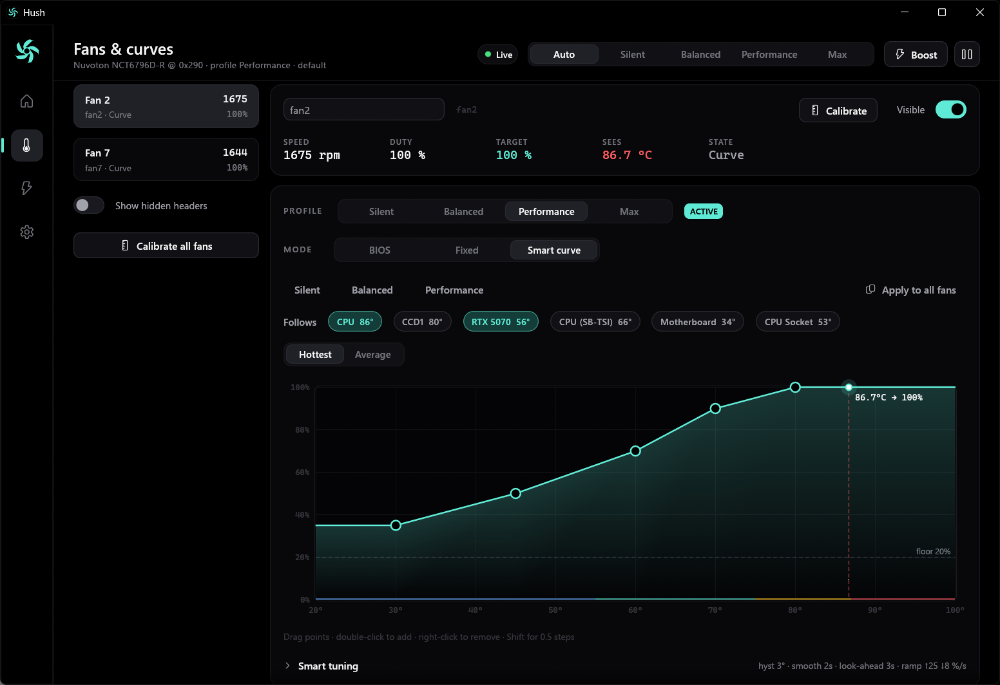
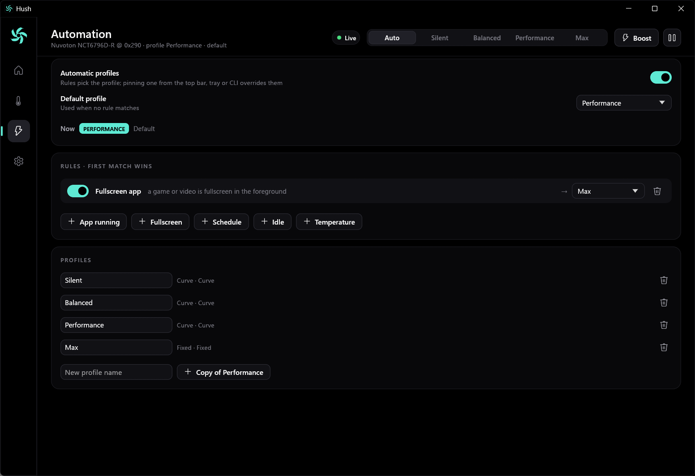
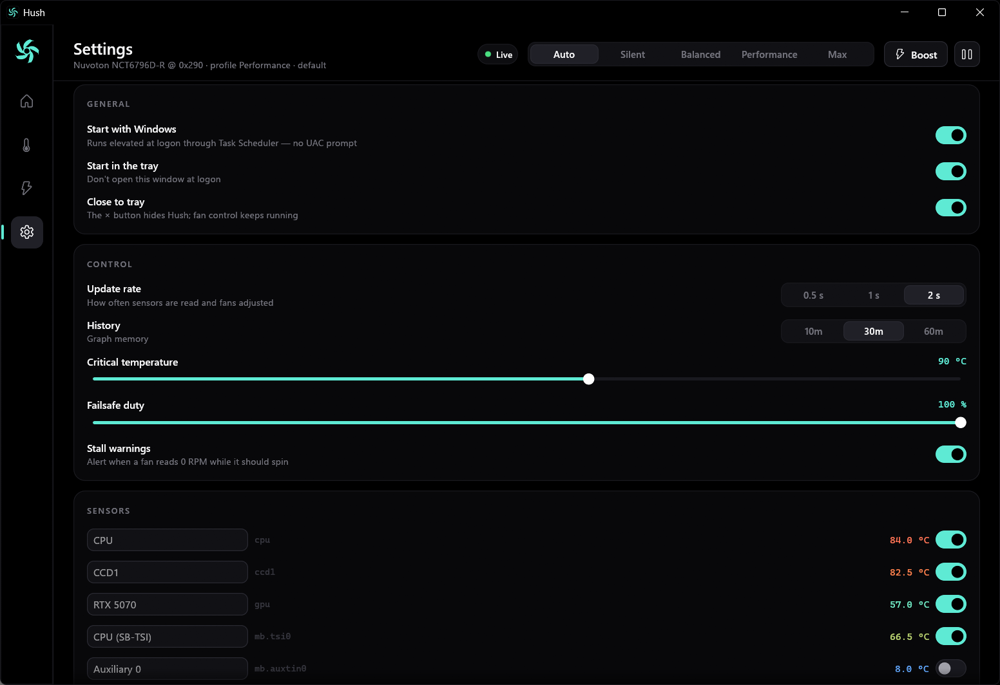

<p align="center">
  
</p>

<h1 align="center">Hush</h1>

<p align="center">
  Quiet, smart fan control for Windows. One small native app, no vendor bloat.<br>
  Curves, profiles, automation, calibration, a CLI and a JSON pipe for scripting.
</p>

<p align="center">
  <a href="https://github.com/visiuun/hush/releases/latest"></a>
  
  
  <a href="LICENSE"></a>
</p>



<table>
  <tr>
    <td></td>
    <td></td>
  </tr>
  <tr>
    <td align="center"><sub>Fans &amp; curves: drag points, live operating point, calibration</sub></td>
    <td align="center"><sub>Automation: switch profiles by app, fullscreen, time, idle or temperature</sub></td>
  </tr>
</table>

```text
> hush status
hush  profile Balanced (Default)

  CPU              54.1 °C
  CCD1             51.8 °C
  RTX 5070         41.0 °C
  Motherboard      34.0 °C

  CPU Fan          1012 rpm  ━━━━━━━━━───────  58 %  Curve    @ 55 °C
  Rear              788 rpm  ━━━━━━━─────────  41 %  Curve    @ 55 °C

> hush profile silent            # pin a profile
> hush set rear 70               # one fan at 70 %, on top of the profile
> hush boost 30                  # everything to 100 % for 30 s
> hush profile auto              # back to automatic
```

## Install

1. Download **`Hush-Setup-x.y.z.exe`** from [Releases](https://github.com/visiuun/hush/releases/latest) and run it.
2. That's it. The installer sets up everything Hush needs:
   - the [PawnIO](https://pawnio.eu) driver (signed; the same one LibreHardwareMonitor and FanControl use),
   - a logon task so Hush starts with Windows, elevated, without a UAC prompt,
   - the `hush` command on your `PATH`,
   - a Start menu shortcut.

Prefer no installer? Grab **`Hush-x.y.z-portable.zip`**, extract it anywhere and run `hush-app.exe`. On first launch it installs the PawnIO driver (downloaded from its official release) and registers the startup task by itself. You can turn that off in Settings.

> Windows SmartScreen may warn about an unknown publisher because the binaries aren't code-signed. Click *More info → Run anyway*, or build from source.

**Requirements:** Windows 10 1809+ or Windows 11, x64, and a desktop motherboard with a supported fan controller or a laptop Hush can drive (see [Hardware](#hardware)).

## Features

**Smart control.** Every fan runs its own pipeline, once a second:

| Step | What it does |
|---|---|
| Source | One or more sensors, mixed as *hottest* or *average* (default: hottest of CPU and GPU) |
| Smoothing | Exponential filter, so spiky CPU temperatures don't make fans hunt |
| Hysteresis | The temperature has to drop *n* °C before a fan slows down |
| Look-ahead | Rising temperatures are extrapolated a few seconds, so fans react before heat soaks in |
| Curve | Piecewise-linear, edited by dragging points on a graph |
| Zero-RPM / floor | Optional stop band with its own hysteresis, or a floor kept above the fan's measured stall point |
| Ramp limits | Separate %/s rates for speeding up and slowing down: fans fade instead of jumping |
| Kick-start | A stopped fan gets a short burst at its measured start duty |
| Writes | Registers are only written when the value changes (plus a reassert every 10 s) |

**Profiles.** *Silent*, *Balanced*, *Performance* and *Max* (every fan at 100 %, a permanent boost) out of the box. Each profile holds a mode per fan: BIOS, fixed duty, or a smart curve. Add, rename, copy and edit as many as you like.

**Automation.** Rules pick the profile, first match wins:

- **App running**: any of `game.exe, blender.exe, …`
- **Fullscreen app** in the foreground (games, video)
- **Schedule**: `23:00–07:00` (wraps midnight)
- **Idle** for *n* minutes
- **Temperature above** a threshold (released 3 °C below it)

Pinning a profile from the top bar, the tray or `hush profile <name>` overrides the rules until you go back to *Auto*.

**Calibration.** About 90 s per fan: Hush measures max RPM, the duty where the fan stalls and the duty it needs to start again. Curve floors and kick-starts then use the real numbers, and empty headers get detected and hidden.

**Safety first.**

- **Critical temperature**: any CPU/GPU sensor at or above the limit (default 90 °C) sends every fan to 100 %.
- **Lost sensors**: fans whose curve sensors disappear go to a failsafe duty.
- **Stall detection**: a fan that should spin but reads 0 RPM raises an alert.
- **Exit, crash or panic**: every header is handed back to the BIOS Smart Fan configuration it had before. The original state is written to disk the moment a header is taken over, so even a hard kill or power loss can't leave you with a "manual" state as the new original.
- **GPU fans are never touched.** Hush only reads GPU temperatures; the graphics driver keeps its fans.

**Light.** Native Rust, no runtime, no web view, no telemetry. The daemon idles at a fraction of a percent of CPU and stops rendering entirely while the window is hidden.

**Little things.** OLED-black UI, tray menu with profiles / boost / pause, rename and hide fans and sensors, 1–60 min history graphs, keyboard shortcuts `1`–`4` for the pages. Click the logo.

## Using Hush

### The window



| Page | |
|---|---|
| **Overview** | CPU, GPU and board temperatures, every fan with RPM, duty and mode, temperature and fan history |
| **Fans & curves** | Pick a fan and a profile, set BIOS / Fixed / Curve, drag the curve, tune smoothing, hysteresis, look-ahead, ramps, zero-RPM; calibrate; rename or hide |
| **Automation** | Base profile and rules |
| **Settings** | Startup, tray behaviour, update rate, critical temperature, failsafe duty, history length, hardware status, CLI |

The top bar always has the profile switcher (*Auto · Silent · Balanced · Performance · Max*), **Boost** (60 s at 100 %) and **Pause** (hand everything to the BIOS). Closing the window keeps Hush running in the tray.

### Command line

`hush.exe` talks to the running app and needs no admin rights. It starts Hush if it isn't running.

```text
hush                         open the window
hush status [--json] [-w]    temperatures, fans, profile (live with --watch)
hush profile                 list profiles
hush profile silent|auto     pin a profile / back to automatic
hush set fan2 60             fixed 60 %          (fan id, number, or the name you gave it)
hush set pump max            fixed 100 %
hush set pump bios           hand one header back to the BIOS
hush set fan7 performance    preset curve override
hush reset [fan]             clear overrides
hush boost 30 | off          all fans 100 % for 30 s
hush pause | resume          hand everything to the BIOS / take it back
hush calibrate all|fan2      measure fans (--cancel to stop)
hush automation on|off       rules on or off
hush startup on|off          start at logon (elevated task, no UAC prompt)
hush start                   start in the tray
hush show [page]             open the window (overview, fans, automation, settings)
hush quit                    exit; every fan returns to BIOS control
hush raw '{"cmd":"status"}'  send a raw JSON request
```

Fans can be addressed as `fan2`, `2`, or by the name you gave them (`pump`, `rear`, even a prefix like `fro` for "Front").

### Scripting (JSON pipe)

Anything that can open a named pipe can drive Hush: send one JSON line to `\\.\pipe\hush`, read one JSON line back.

```json
{"cmd":"status"}
{"cmd":"profiles"}
{"cmd":"profile","name":"Silent"}
{"cmd":"profile","name":null}
{"cmd":"set","fan":"fan2","mode":{"kind":"fixed","duty":55}}
{"cmd":"set","fan":"pump","mode":{"kind":"bios"}}
{"cmd":"reset","fan":null}
{"cmd":"boost","seconds":45}
{"cmd":"pause","on":true}
{"cmd":"automation","on":false}
{"cmd":"calibrate","fans":["all"]}
{"cmd":"show","page":"fans"}
{"cmd":"quit"}
```

Replies look like `{"ok":true,"message":"…","data":{…}}`. `status` returns every sensor, fan (RPM, duty, target, mode, source temperature, stall flag), the active profile and why it's active.

<details>
<summary>PowerShell</summary>

```powershell
function Hush($req) {
    $pipe = New-Object System.IO.Pipes.NamedPipeClientStream('.', 'hush', 'InOut')
    $pipe.Connect(2000)
    $w = New-Object System.IO.StreamWriter($pipe); $w.AutoFlush = $true
    $w.WriteLine(($req | ConvertTo-Json -Compress -Depth 5))
    $r = (New-Object System.IO.StreamReader($pipe)).ReadLine() | ConvertFrom-Json
    $pipe.Dispose(); $r
}

Hush @{ cmd = 'profile'; name = 'Silent' }
(Hush @{ cmd = 'status' }).data.fans | Format-Table name, rpm, duty, mode
```
</details>

<details>
<summary>Python</summary>

```python
import json

def hush(**req):
    with open(r"\\.\pipe\hush", "r+b", buffering=0) as p:
        p.write((json.dumps(req) + "\n").encode())
        return json.loads(p.readline())

hush(cmd="boost", seconds=30)
cpu = next(s for s in hush(cmd="status")["data"]["sensors"] if s["id"] == "cpu")
print(cpu["value"])
```
</details>

<details>
<summary>AutoHotkey v2</summary>

```autohotkey
; Win+F12 → toggle the Max profile
#F12:: {
    static on := false
    on := !on
    Run 'hush profile ' (on ? 'max' : 'auto'),, 'Hide'
}
```
</details>

Stream Deck, Home Assistant agents, game launchers, batch files: anything that can run `hush …` or open the pipe works.

## Hardware

Hush talks to the motherboard's Super I/O chip, the part that actually drives the fan headers.

| Controller | Found on | Status |
|---|---|---|
| Nuvoton NCT6779D, NCT6791D, NCT6792D, NCT6793D, NCT6795D, NCT6796D(-R), NCT6797D, NCT6798D, NCT6799D | ASUS, ASRock, Biostar, some MSI / Gigabyte | ✅ Tested on NCT6796D-R (ASRock B550) |
| Nuvoton NCT6683D, NCT6686D, NCT6687D | MSI (300 – 700 series) | Supported, feedback welcome |
| Nuvoton NCT6687D-R | MSI 800 series | Monitoring only for now |
| ITE IT8613E, IT8620E, IT8625E, IT8628E, IT8631E, IT8638E, IT8655E, IT8665E, IT8686E, IT8688E, IT8689E, IT8696E, IT8721F, IT8728F, IT8772E, IT8792E, IT87952E | Gigabyte, many OEM boards | Supported, feedback welcome |

| Sensors | |
|---|---|
| AMD Ryzen (Zen 1 – Zen 5) | Tctl and per-CCD temperatures ✅ tested on Zen 3 |
| Intel Core (Nehalem and newer) | Package temperature |
| NVIDIA GPUs | Temperature, power, load (NVML) ✅ tested |
| AMD / Intel GPUs | Temperature (WDDM, same as Task Manager) |
| Motherboard | Whatever the Super I/O exposes (board, socket, chipset, VRM, …) |

### Laptops

Laptop fans are run by the embedded controller (EC), and every vendor wires it differently, so there is no single way in. Hush has two:

> **Status:** ✅ tested on an **ASUS Zenbook 14 (UM3406KA)**. Every other laptop, including other ASUS models (ROG / TUF fan curves) and every other brand through NBFC configs, is **untested and might not work**. If you try it, please [open an issue](https://github.com/visiuun/hush/issues/new/choose) with what happened and `hush status --json`.

| Laptop | How | What you get |
|---|---|---|
| **ASUS** (Zenbook, Vivobook, ROG, TUF) | ASUS's own firmware interface (`ATKACPI`, installed with MyASUS / Armoury Crate or Windows Update), nothing to set up | Fan RPM and EC temperatures on every model. Full curves on models with custom fan curves (most ROG / TUF, some Zenbook / Vivobook). Everywhere else (Zenbook 14 UM3406, for one) Hush profiles switch the firmware fan mode: *Silent* → Whisper, *Balanced* → Standard, *Performance* → Performance, and automation rules switch it for you. *Max*, Boost and the critical-temperature failsafe also flip the firmware's force-full-speed switch where it has one. Variable fan speeds aren't reachable on these models: the firmware only exposes them to the BIOS |
| **Any other laptop** (Acer, HP, Lenovo, Dell, MSI, Clevo, …), untested | A [NoteBook FanControl](https://github.com/nbfc-linux/nbfc-linux/tree/main/share/nbfc/configs) model config | Full control of every fan the config describes |

For the second route, find your model in the [nbfc-linux config list](https://github.com/nbfc-linux/nbfc-linux/tree/main/share/nbfc/configs) (300+ models), save it as `%ProgramData%\Hush\laptop.json` and restart Hush. Settings → Hardware shows the model it loaded and warns if the config was made for a different one. EC values aren't RPM, so these fans show duty only and skip calibration. Use a config for your exact model: the wrong one writes the wrong EC registers. Configs that drive fans through ACPI methods or Lua scripts aren't supported.

On exit, pause or crash, laptop fans go back to the firmware the same way desktop headers go back to the BIOS (the original ASUS mode / the config's reset values). Don't run Hush next to another laptop fan tool (Armoury Crate fan control, G-Helper, NBFC, OMEN Gaming Hub, Lenovo Vantage, …).

Not supported: prebuilt OEM desktops (Dell, HP, Lenovo) with a proprietary fan controller, and laptops that are neither ASUS nor covered by an NBFC config. On some recent Gigabyte boards the second ITE chip is supervised by a Gigabyte EC that can override manual control on its headers.

If your board isn't detected, open **Settings → Hardware**: it says which chip was found and why it was rejected. Please [open an issue](https://github.com/visiuun/hush/issues/new/choose) with that line and `hush status --json`.

Hush shares the hardware bus politely (the standard `Access_ISABUS` / `Access_PCI` mutexes), so HWiNFO, LibreHardwareMonitor and friends can run alongside it. Don't run two *fan controllers* at once (Hush plus FanControl, Armoury Crate, A-Tuning, MSI Center, SIV, …): they will fight over the same registers.

## How it fits together

```text
hush-app.exe  (elevated, tray + window)
 ├─ engine thread    sensors → per-fan pipeline → register writes, once per tick
 ├─ hardware hub     PawnIO modules: LpcIO (Super I/O), AMDFamily17 / IntelMSR (CPU); NVML / WDDM (GPU)
 ├─ automation       pinned profile → first matching rule → base profile
 └─ pipe server      \\.\pipe\hush  ←  hush.exe, scripts, Stream Deck, …
```

Hush never loads a generic "read/write any port" driver. PawnIO only runs small signed modules that whitelist exactly what they may touch, unlike WinRing0, which is flagged by Defender for good reason.

## Files

| | |
|---|---|
| Config | `%APPDATA%\Hush\config.json` (written atomically) |
| Log | `%APPDATA%\Hush\hush.log` |
| BIOS fan state (only while Hush controls a header) | `%ProgramData%\Hush\bios-fan-state.json` |
| Startup | Task Scheduler → `Hush Fan Control` |

## Uninstall

*Settings → Apps → Hush → Uninstall* (or `unins000.exe` in the install folder). Fans go back to BIOS control, the startup task and the `PATH` entry are removed. Your config stays in `%APPDATA%\Hush`; delete it if you want a clean slate. PawnIO is left installed because other tools may use it; remove it from *Apps* if you don't need it.

Portable: `hush quit`, `hush startup off`, delete the folder.

## Building from source

```powershell
# Rust stable (x86_64-pc-windows-msvc)
git clone https://github.com/visiuun/hush
cd hush
cargo build --release          # target\release\hush-app.exe + hush.exe

# Installer + portable zip into .\dist (needs Inno Setup 6: winget install JRSoftware.InnoSetup)
powershell -ExecutionPolicy Bypass -File scripts\release.ps1
```

The C runtime is linked statically (`.cargo/config.toml`), so the binaries run on a clean Windows install without any redistributables.

| Path | |
|---|---|
| `src/hw/` | Hardware: PawnIO client, Nuvoton / ITE drivers, CPU and GPU sensors |
| `src/engine.rs` | Control loop, curves, calibration, safety |
| `src/automation.rs` | Rule evaluation |
| `src/ipc.rs` | Named-pipe protocol |
| `src/main.rs` | `hush` CLI |
| `src/app/` | `hush-app`: window, tray, custom widgets and graphs (egui) |
| `installer/` | Inno Setup script |

## Credits

- [PawnIO](https://pawnio.eu) by namazso: the driver and the signed modules in `assets/pawnio` (LGPL-2.1, see `assets/pawnio/COPYING`).
- Register maps for the Super I/O chips are based on the research in [LibreHardwareMonitor](https://github.com/LibreHardwareMonitor/LibreHardwareMonitor) and the Linux `nct6775`, `nct6683` and `it87` drivers.
- Built with [egui](https://github.com/emilk/egui), [tray-icon](https://github.com/tauri-apps/tray-icon), [nvml-wrapper](https://github.com/rust-nvml/nvml-wrapper) and [windows-rs](https://github.com/microsoft/windows-rs).

## License

Hush is © 2026 visiuun, released under [CC BY-NC 4.0](LICENSE).

You're free to use, share, modify and build on it, **as long as you credit "Hush by visiuun" with a link to this repository** and **don't use it commercially**. For commercial use, ask first.
